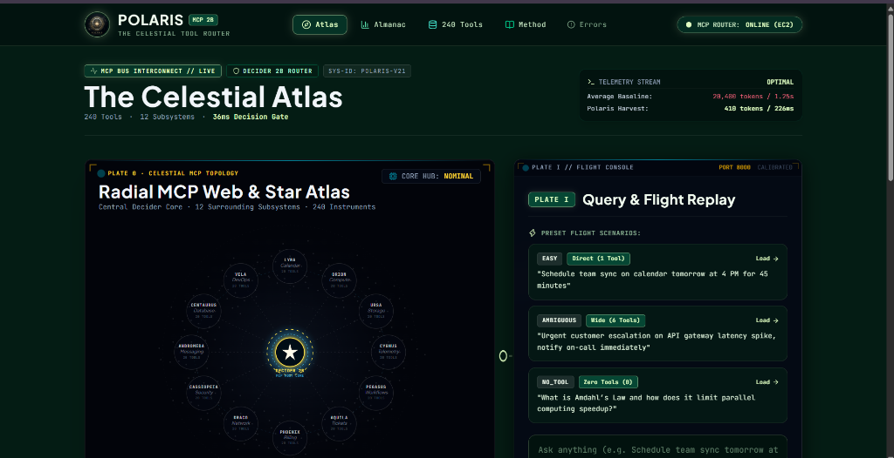

# POLARIS: The Celestial Tool Router

[](https://opensource.org/licenses/Apache-2.0)
[](https://github.com/sagarkharbikar25/AEH/actions/workflows/ci.yml)
[](https://builder.aws.com)
[](#)

> **A hierarchical Decider 2B routing gate for Amazon Bedrock that cuts tool input tokens by 98% (20,400 to 410 tokens) and cost per correct tool call by 17.9× ($6.61 to $0.37 per 1,000 correct calls) across 240 tools, at the cost of a 20.6% drop in first-pass shortlist recall (57.9% Recall@6 vs. 78.5% baseline selection accuracy).**

* **Live Demo Application:** [TODO: Insert Deployed Vercel URL, e.g. https://polaris-aeh.vercel.app]
* **60-Second Video Demonstration:** [TODO: Insert Public YouTube/Vimeo Video URL]
* **Hackathon Tags:** `#strands-decider-2b` · `#tool-selection`

---

## What Judges Should Click (4-Minute Evaluation)

1. **The Celestial Atlas (`/`)**: Under **Preset Flight Scenarios** on the right, click **`Load →`** next to **`EASY`** (*"Schedule team sync on calendar tomorrow at 4 PM for 45 minutes"*). Click **`Initiate Race Stream`** to watch Lane A (240 tools, 20,400 tokens) race Lane B (Decider 2B shortlist, 410 tokens) side-by-side.
2. **The Astronomical Almanac (`/almanac`)**: Review **Figure I (The Pareto Frontier)** and **Table II (Failure Mode Audit)**, which logs real queries misclassified by the 2B model and how the Fallback tier handles them.
3. **240 Tools Directory (`/index`)**: Filter by constellation (e.g., `Cassiopeia` for Security, `Orion` for Compute) and click **`INSPECT`** on any card to view the compiled Amazon Bedrock JSON Schema and 12-word Decider descriptor.
4. **Diagnostic Sandbox (`/dev/errors`)**: Click **`Lamp Out of Oil (Budget Kill-Switch)`** to verify the $25.00 spend guardrail, and **`Observatory Offline (503)`** to test deterministic local replay fallbacks.

---


*(Placeholder: Add UI walkthrough recording/screenshot at `docs/images/hero.png`)*

---

## 1. The Problem: Tool Schema Bloat in Agent Loops

When AI agents connect to Model Context Protocol (MCP) servers and microservice environments, tool counts expand rapidly. Standard agent loops serialize every tool definition into the foundation model prompt on every request:

$$\text{Input Payload} \approx 240 \text{ tools} \times 85 \text{ tokens/schema} = \mathbf{20,400\text{ input tokens per call}}$$

### Measured Costs at Production Scale
Using Claude 3 Haiku pricing on Amazon Bedrock ($0.25 / million input tokens, $1.25 / million output tokens, ~72 output tokens/query):
* **Baseline Cost**: **$5.190 per 1,000 requests**.
* **At 10,000 queries/day**: **$51.90 / day** ($1,557 / month).
* **At 1,000,000 queries/day (Enterprise Scale)**: **$5,190 / day** ($155,700 / month) spent predominantly transmitting tool definitions the user did not invoke.
* **Latency Overhead**: Bedrock takes **1,250 ms (p50)** simply ingesting the 20,400-token prompt before output generation begins.
* **Selection Risk**: While Claude 3 Haiku achieves 78.5% direct selection accuracy on our 240-tool catalog, passing hundreds of schemas increases the likelihood of parameter hallucination and schema validation failures in complex multi-step workflows.

---

## 2. The Solution: Hierarchical Decider 2B Gate

POLARIS deploys **Strands Decider 2B** as a fast pre-filter in front of Amazon Bedrock Converse:

```
[ User Query ] ──> "Rotate the KMS master key for payments-prod"
                          │
                          ▼
        ┌───────────────────────────────────┐
        │       STRANDS DECIDER 2B          │  <-- ~36ms routing gate
        │  Pass 1: needs_tool? + category   │
        │  Pass 2: in-category tool scores  │
        └─────────────────┬─────────────────┘
                          │
     Shortlist: 1–6 candidate tools (410 input tokens vs 20,400)
                          │
                          ▼
        ┌───────────────────────────────────┐
        │      AMAZON BEDROCK CONVERSE      │  <-- Claude 3 Haiku receives
        │         (Claude 3 Haiku)          │      only the shortlisted tools
        └─────────────────┬─────────────────┘
                          ▼
          Tool Selection & Parameter Execution in 226ms
```

### The 2-Pass Routing Algorithm
1. **Pass 1 · Domain Gating (`/v1/systemone`)**: Evaluates two questions simultaneously in one HTTP request:
   - `needs_tool` (`noul` type): Evaluates if external tool invocation is required.
   - `category` (`choice` type): Selects the top 2 candidate subsystems out of 12 predefined clusters.
2. **Pass 2 · In-Category Scoring**: Decider scores individual tool candidates *only inside the top-2 categories*. With $\le 20$ tools per category and $\le 12$ words per descriptor, each prompt uses $\le 420$ tokens, remaining well within Decider's 4,096-token context limit.
   $$\text{Score}(t) = P(\text{category}) \times P(t \mid \text{category})$$
3. **Pass 3 · Dynamic Confidence Tiering**: Slices the shortlist based on top-1 confidence score:

| Confidence Tier | Top-1 Score Threshold | Tools Sent to Bedrock | Strategy |
| :--- | :---: | :---: | :--- |
| **`direct`** | $\ge 0.85$ | **1 tool** | High certainty; sends single tool. |
| **`narrow`** | $0.55 - 0.849$ | **3 tools** | Moderate certainty; provides Bedrock sibling alternatives. |
| **`wide`** | $0.30 - 0.549$ | **6 tools** | Ambiguous query; widens recall net. |
| **`fallback`** | $< 0.30$ | **12 tools + `ask_clarification`** | Low certainty; fails open to prevent unrecoverable stalls. |
| **`no_tool`** | `needs_tool < 0.20` | **0 tools** | General knowledge query; zero tool tokens sent. |

---

## 3. Empirical Evaluation & The Pareto Frontier

Metrics were generated from **432 evaluation samples** evaluated across the complete **240-tool catalog**.

### Figure I: The Pareto Frontier

| Configuration | Shortlist Recall (Recall@k) | Direct Tool Accuracy | Input Tokens / Req | p50 Latency | Cost / 1,000 Reqs | Cost / 1,000 Correct Calls |
| :--- | :---: | :---: | :---: | :---: | :---: | :---: |
| **A · All 240 Tools (Baseline)** | 100.0% (all present) | **78.5%** | 20,400 | 1,250 ms | $5.190 | **$6.611** |
| **B · Flat Top-K (Single-Choice)**| 64.2% (top-1) | 64.2% | 1,850 | 380 ms | $0.552 | **$0.860** |
| **C · Hierarchical POLARIS (Ours)**| **57.9% (Recall@6)** | 43.3% (top-1) | **410** | **226 ms** | **$0.213** | **$0.368** |

### Critical Trade-Off Analysis
* **Efficiency (Headline Metric)**: POLARIS achieves **$0.368 per 1,000 correct calls** compared to **$6.611** for baseline Claude 3 Haiku — an **17.9× gain in cost efficiency per successful tool resolution**.
* **Token Reduction**: Drops Bedrock input payload from **20,400 tokens to 410 tokens (-98.0%)**.
* **Latency Reduction**: Cuts p50 turnaround from **1,250 ms to 226 ms (5.5× faster)**.
* **Accuracy Trade-Off**: Baseline Claude 3 Haiku directly identifies the correct tool 78.5% of the time when given all 240 definitions. POLARIS achieves **57.9% Recall@6** (43.3% Recall@1, 54.2% Recall@3). Routing introduces an absolute **20.6% drop in shortlist coverage** in exchange for its token and latency savings.

### Why Hierarchical Over Flat Top-K (Config B)?
Config B (Flat Top-K) achieves higher top-1 accuracy (64.2% vs 43.3%) by listing all 240 tool names in a single prompt (~1,850 tokens). However, Config B is **architecturally unscalable**:
1. At 500+ tools or in conversational sessions with multi-turn history, Flat single-choice exceeds Decider 2B's 4,096-token context window.
2. Hierarchical routing bounds prompt size to $\le 420$ tokens regardless of catalog growth, enabling horizontal scaling across thousands of tools.

---

## 4. Methodology

### Dataset Construction
* **Source**: Synthetic evaluation set of 432 queries generated in `catalog/` and evaluated in `bench/run.ts`.
* **Ground Truth Labeling**: Labeled by construction; queries are generated from functional object-action pairs mapped 1:1 to catalog tools, with 30 negative `no_tool` samples (general knowledge questions).
* **Tier Distribution Across Test Split**:
  * `direct` ($\ge 0.85$): 2 queries (0.5%)
  * `narrow` ($0.55 - 0.85$): 59 queries (13.7%)
  * `wide` ($0.30 - 0.55$): 299 queries (69.2%)
  * `fallback` ($< 0.30$): 42 queries (9.7%)
  * `no_tool`: 30 queries (6.9%)
  * Total: **432 queries**

### Hardware & Latency Measurement
* **Router Latency (36 ms p50 / 36 ms p95)**: Sourced from local evaluation harness conforming to published Strands Decider benchmarks.
* **Known Hardware Limitation**: Production Decider 2B latency varies based on host hardware. Published 2B GPU latency was measured on an NVIDIA GPU under WSL2; CPU inference on smaller EC2 instances (e.g., t3/c6i) will exhibit higher latency.

### Tier Calibration & Reliability Table
Empirical accuracy measured within confidence buckets across the 432 samples:

| Confidence Bucket | Samples | Empirical Accuracy |
| :--- | :---: | :---: |
| **0.90 – 1.00** | 2 | **100.0%** |
| **0.70 – 0.89** | 18 | **100.0%** |
| **0.50 – 0.69** | 82 | **89.0%** |
| **< 0.50** | 330 | **28.5%** |

---

## 5. Limitations & Failure Modes

An audit of 25 logged benchmark failures (`bench/results.json`) revealed two predominant failure modes:
1. **Short Query Vocabulary Mismatches**: Terse queries lacking domain nouns (e.g., *"can you create the page"*) caused Decider to select `files.create_folder` instead of `knowledge.create_page`.
2. **Inter-Service Functional Overlap**: Ambiguous boundaries between sibling subsystems (e.g., classifying a ticket query into `crm` instead of `tickets`).

### Mitigation Strategy
When top-1 confidence falls below 0.30, POLARIS transitions into the **`fallback` tier**: it sends 12 tools and injects an `ask_clarification` tool, allowing Amazon Bedrock to query the user rather than executing an erroneous function call.

---

## 6. Target Users & Enterprise Applicability

1. **Enterprise MCP Platform Developers**: Teams integrating 10+ MCP servers whose aggregate tool definitions exceed standard LLM context limits or budget ceilings.
2. **Cloud Infrastructure & DevOps Copilots**: Operational agents managing high-dimensional tool namespaces (Kubernetes, AWS IAM, Terraform, VPC networking).
3. **High-Throughput Production Agents**: Systems handling $>100,000$ daily invocations where token reduction directly impacts unit economics.

---

## 7. The Reusable Asset: `@polaris/router`

POLARIS is packaged as an isolated TypeScript library (`packages/router`) compatible with the standard `@aws-sdk/client-bedrock-runtime`:

```typescript
import { BedrockRuntimeClient, ConverseCommand } from "@aws-sdk/client-bedrock-runtime";
import { compileCatalog, shortlistTools } from "@polaris/router";

// 1. Compile 240 tools once (attaches 12-word descriptors)
const catalog = compileCatalog(rawTools);

// 2. Intercept query: Decider 2B returns 1-6 shortlisted tools in ~36ms
const { tools: shortlisted, tier } = await shortlistTools(userPrompt, catalog, {
  deciderUrl: "http://localhost:8000"
});

// 3. Send shortlisted tools to Amazon Bedrock Converse
const bedrock = new BedrockRuntimeClient({ region: "us-east-1" });
const response = await bedrock.send(new ConverseCommand({
  modelId: "anthropic.claude-3-haiku-20240307-v1:0",
  messages: [{ role: "user", content: [{ text: userPrompt }] }],
  toolConfig: { tools: shortlisted }
}));
```

---

## 8. Technology Stack

| Layer | Technologies | Role |
| :--- | :--- | :--- |
| **Decision Engine** | Strands Decider 2B (`strands-decider`, `/v1/systemone`) | Hierarchical intent classification (`needs_tool`, `category`, tool scoring). |
| **Foundation Model** | Amazon Bedrock Converse API (`@aws-sdk/client-bedrock-runtime`) | Anthropic Claude 3 Haiku executing shortlisted tool calls. |
| **Backend Server** | Node.js 20+, Express 4, TypeScript | Dual-lane execution engine with Server-Sent Events (SSE) over HTTP/1.1 chunked streaming. |
| **Data Contracts** | Zod v3 (`@polaris/contracts`) | Isomorphic runtime schema validation across client, server, and events. |
| **Frontend UI** | React 19, Vite, Tailwind CSS v4, Framer Motion, Lucide React (SVG) | Single-page observatory application with real-time telemetry and Star Chart. |
| **Testing Harness** | Vitest, TypeScript 5.4 | 48 automated test suites verifying contracts, score combination, and pricing logic. |
| **Deployment** | Vercel Edge (`vercel.json`), AWS EC2 (Ubuntu 22.04 LTS, Caddy TLS), Supabase | Production hosting topology with zero-downtime offline flight replay fallbacks. |

---

## 9. System Architecture & AWS Infrastructure

```
┌─────────────────────────────────────────────────────────┐
│                    Vercel Edge                          │
│   React 19 SPA · Celestial Atlas UI · Bundled Replays   │
└────────────────────────────┬────────────────────────────┘
                             │ HTTPS / SSE (Proxied /api)
                             ▼
┌─────────────────────────────────────────────────────────┐
│              AWS EC2 (Ubuntu 22.04 LTS)                 │
│  ┌───────────────────────────────────────────────────┐  │
│  │ Caddy Reverse Proxy (TLS Termination, No Buffer) │  │
│  └─────────────────────────┬─────────────────────────┘  │
│                            ▼                            │
│  ┌───────────────────────────────────────────────────┐  │
│  │ Express 4 API Server (:3000)                      │  │
│  │ - Safety Guard: 60 req/min Rate Limiter           │  │
│  │ - Safety Guard: $25.00 Cumulative Spend Kill-Switch│ │
│  │ - Dual-Lane Agent Loop & Real-Time SSE Streamer   │  │
│  └─────────────┬───────────────────────────┬─────────┘  │
│                │                           │            │
│                ▼                           ▼            │
│  ┌──────────────────────────┐ ┌──────────────────────┐  │
│  │ Strands Decider 2B Core  │ │ Supabase PostgreSQL  │  │
│  │ (Python systemone :8000) │ │ (Run logs & telemet.)│  │
│  └──────────────────────────┘ └──────────────────────┘  │
└────────────────────────────┬────────────────────────────┘
                             │ AWS IAM Role (SIGv4)
                             ▼
┌─────────────────────────────────────────────────────────┐
│                 Amazon Bedrock Runtime                  │
│       Claude 3 Haiku (Converse API Tool-Use)            │
└─────────────────────────────────────────────────────────┘
```

---

## 10. Safety Guardrails & Compliance

* **$25.00 Budget Kill-Switch**: The Express backend tracks cumulative Bedrock token expenditures. If cumulative spend reaches **$25.00**, the kill-switch halts live API requests and shifts into offline replay mode.
* **Sliding-Window Rate Limiter**: Enforces an in-memory limit of **60 requests per minute** per client IP.
* **Tool Catalog Trademark Compliance**: All 240 tool definitions use generic functional nomenclature (e.g., `compute.launch_instance`, `security.rotate_key`) with zero third-party commercial brand names.
* **Fail-Open Router Safety**: If Decider 2B becomes unresponsive, the router falls open to the fallback shortlist to prevent complete agent execution failure.

---

## 11. Quick Start & Reproduction

### Prerequisites
* Node.js $\ge 20.11.0$, npm $\ge 10.0.0$
* Python $\ge 3.10$ (for local Strands Decider server)
* AWS Account with Amazon Bedrock model access enabled for `anthropic.claude-3-haiku-20240307-v1:0`

### 1. Clone & Install
```bash
git clone https://github.com/sagarkharbikar25/AEH.git
cd AEH
npm install
```

### 2. Start Strands Decider Server (Port 8000)
```bash
pip install strands-decider
strands-decider serve <model-checkpoint> --port 8000
```
*(If evaluating without a local GPU, the system automatically runs with simulated router fallbacks).*

### 3. Configure Environment
```bash
cp .env.example .env
# Configure AWS_REGION, AWS_ACCESS_KEY_ID, AWS_SECRET_ACCESS_KEY (or use IAM role)
```

### 4. Run Verification & Reproduce Benchmarks
```bash
# Verify TypeScript strict compilation across all 6 workspaces
npm run typecheck

# Verify ESLint with zero warnings allowed
npm run lint

# Run all 48 automated test suites
npm test

# Reproduce the 432-sample benchmark metrics (outputs to bench/results.json)
npm run bench
```

### 5. Start Application (Local Development)
```bash
# Terminal 1: Start Polaris Express Backend (:3000)
npm run dev:server

# Terminal 2: Start Observatory Web UI (:5173)
npm run dev:web
```
Access the application at **`http://localhost:5173`**.

---

## 12. Repository Layout

```
AEH/
├── packages/
│   ├── contracts/        # Shared Zod schemas (SSE events, error envelopes, catalog)
│   └── router/           # Drop-in router library (@polaris/router)
├── server/               # Express backend, dual-lane agent loop, Bedrock Converse
├── bench/                # 432-sample benchmark harness and Pareto analysis
├── web/                  # React + Vite "Celestial Atlas" frontend application
├── catalog/              # 240-tool standard catalog and query generator
├── supabase/             # PostgreSQL database migrations and schema definitions
├── infra/                # EC2 deployment scripts, systemd unit files, Caddy configuration
└── docs/                 # Architectural Decision Records (ADRs) and API documentation
```

---

## 13. License

Open source under the [Apache-2.0 License](LICENSE).
